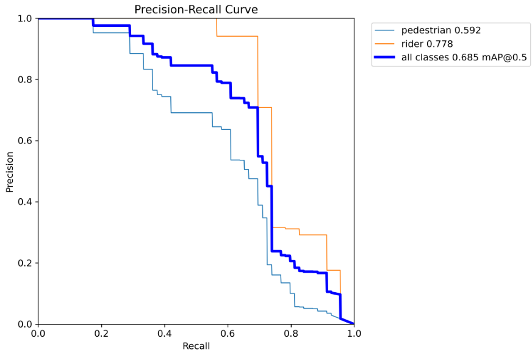
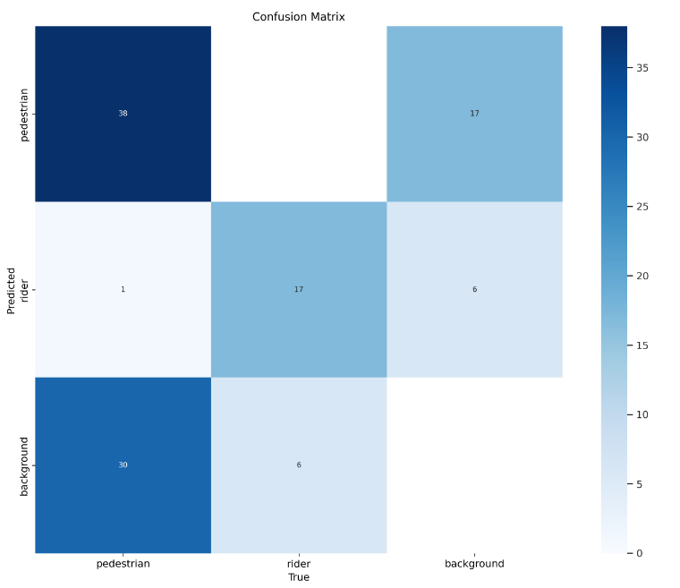
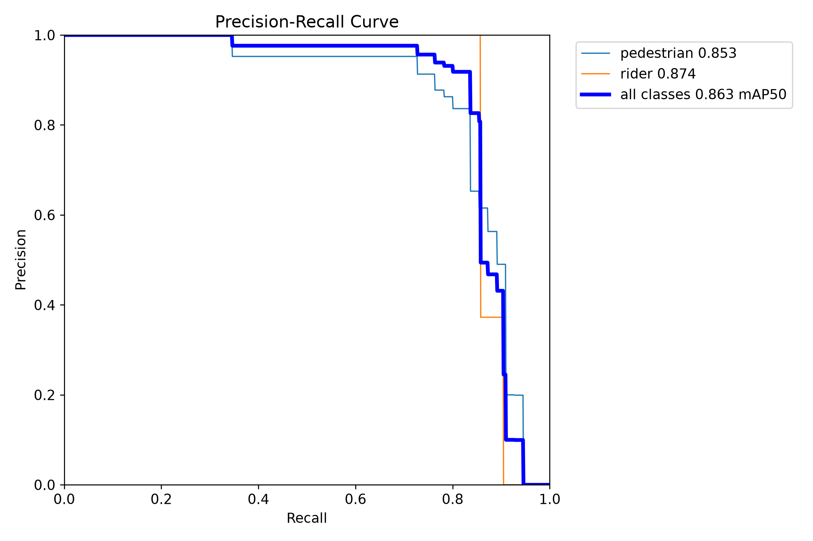

# Détection de piétons et de cyclistes pour les systèmes d'aide à la conduite (ADAS)

Projet de session du cours **PIF6004** (Université du Québec à Trois-Rivières, été 2024), dont le thème était les applications embarquées ou mobiles pour les systèmes d'aide à la conduite automobile.

*English summary below.*

**[Essayer la démo en ligne](https://mireille-kafando.github.io/demo-pietons/)** · [Live demo](https://mireille-kafando.github.io/demo-pietons/)

## En bref

L'objectif était de détecter les piétons (`pedestrian`) et les cyclistes (`rider`) dans des scènes urbaines, une fonction centrale des systèmes avancés d'aide à la conduite. Trois approches ont été implémentées et comparées :

1. **EfficientNetB0 à deux têtes** : classification de la présence des classes et régression des boîtes englobantes, sur Cityscapes.
2. **Segmentation U-Net** des piétons, sur Cityscapes.
3. **YOLOv8n**, entraîné sur un jeu de 75 images annoté à la main avec CVAT.

YOLOv8 donne les meilleurs résultats (**mAP@0,5 = 0,685**). Il a été déployé dans trois interfaces : **Streamlit**, **Gradio** et **Flask**.

**Version 2 (2026).** Le modèle YOLOv8n a été réentraîné à partir de poids pré-entraînés sur COCO, avec un jeu de test séparé. Sur ce test, le mAP@0,5 passe de 0,550 (v1) à **0,863** (v2), un écart dont l'intervalle de confiance à 95 % par bootstrap est [+0,14 ; +0,48]. Détails dans [`v2/`](v2/) et dans la section « Version 2 » ci-dessous.

## Démarche

| Étape | Contenu | Notebook |
|---|---|---|
| Phase préliminaire | Propositions de régions (Felzenszwalb) + caractéristiques VGG16 + SVM ; essai de YOLOv5 sur Cityscapes | `01_preliminaire_vgg16_svm_yolov5` |
| YOLOv5 / YOLOv8 sur Cityscapes | Conversion des polygones Cityscapes en boîtes YOLO. Les entraînements échouent (« No labels found ») | `02_…`, sections 1 et 2 |
| YOLOv8 sur un jeu annoté à la main | YOLOv8n, 60 images d'entraînement, 15 de validation, 250 époques, lot de 8 | `02_…`, section 3 |
| EfficientNetB0 à deux têtes | Base EfficientNetB0 (ImageNet) + tête de classification + tête de régression des boîtes, 7 000 237 paramètres ; 2 489 images d'entraînement, 160 de validation | `02_…`, section 4 |
| U-Net | Encodeur-décodeur 512 × 512, régularisation L2, perte d'entropie croisée + Jaccard, 7 771 970 paramètres ; post-traitement par fermeture morphologique | `02_…`, section 5 |

## Résultats

| Approche | Données | Résultats |
|---|---|---|
| **YOLOv8n** | 75 images annotées (CVAT) ; 92 instances en validation | Précision 0,831 · Rappel 0,536 · **mAP@0,5 0,685** · mAP@0,5:0,95 0,377 |
| — piétons | | mAP@0,5 0,592 |
| — cyclistes | | mAP@0,5 0,778 |
| **YOLOv8n v2** (2026) | Mêmes 75 images ; test séparé de 14 images, 76 instances | Précision 0,955 · Rappel 0,794 · **mAP@0,5 0,863** · mAP@0,5:0,95 0,534 (voir « Version 2 ») |
| EfficientNetB0 | Cityscapes | Exactitude de classification (validation) 81,3 % · perte de régression ≈ 3 600 · rappel moyen 0,471 · F1 0,446 |
| U-Net | Cityscapes | Par pixel : rappel 0,272 · F1 0,052. Après post-traitement : rappel 0,004 · précision 0,303 · F1 0,007 · G-Mean 0,060 |

Valeurs lues dans les sorties du notebook de la phase 2.

<p align="center">
  
  
</p>

Les courbes d'entraînement d'EfficientNetB0 et d'U-Net sont dans [`results/figures/`](results/figures/).

## Version 2 (2026)

La v2 reprend YOLOv8n et les mêmes 75 images, en corrigeant trois limites de la v1 : pas de poids pré-entraînés, des poids choisis et évalués sur les mêmes images, et une image de validation présente deux fois. Elle part des poids COCO (`yolov8n.pt`) et répartit les images en trois ensembles disjoints : 48 pour l'entraînement, 12 pour choisir les poids et 14 pour le test, utilisé une seule fois.

| Test (14 images, 76 instances) | Précision | Rappel | mAP@0,5 [IC 95 %] | mAP@0,5:0,95 [IC 95 %] |
|---|---|---|---|---|
| v1 (poids déployés) | 0,577 | 0,566 | 0,550 [0,40 ; 0,70] | 0,223 [0,15 ; 0,30] |
| **v2** | **0,955** | **0,794** | **0,863** [0,79 ; 0,94] | **0,534** [0,49 ; 0,61] |
| Différence v2 − v1 | | | **+0,314** [0,14 ; 0,48] | **+0,311** [0,24 ; 0,43] |

Intervalles à 95 % obtenus par bootstrap sur les images (2 000 rééchantillonnages). Avec 14 images de test, les scores restent indicatifs. Protocole, figures et scripts : [`v2/README.md`](v2/README.md).

<p align="center"></p>

## Interfaces

Les trois interfaces chargent les poids YOLOv8 de [`models/best.pt`](models/best.pt) (6 Mo). Elles reçoivent une image et renvoient l'image annotée avec les boîtes détectées.

```bash
pip install -r requirements.txt

streamlit run app/streamlit_app.py      # interface remise avec le projet
python app/gradio_app.py                # variante Gradio
cd app/flask_app && python app.py       # variante Flask (http://127.0.0.1:5000)
```

Le manuel d'utilisation est dans [`docs/manuel_utilisateur_interface.pdf`](docs/manuel_utilisateur_interface.pdf).

Le seul changement apporté au code d'origine concerne le chemin du modèle. Il pointait vers un dossier Windows local et a été rendu relatif au dépôt.

**Démo en ligne : [mireille-kafando.github.io/demo-pietons](https://mireille-kafando.github.io/demo-pietons/).** Ajoutée en 2026, elle exécute les poids de la v2, ou ceux de la v1 pour comparer, exportés au format ONNX, directement dans le navigateur avec ONNX Runtime Web. Elle propose un seuil de confiance réglable et le nombre de détections par classe. Sur l'image d'exemple, elle retrouve les mêmes détections qu'Ultralytics. Elle corrige aussi l'ordre des canaux de couleur (voir les écarts ci-dessous).

Le dossier [`demo/`](demo/) contient le script d'export ONNX et une version Gradio de la démo (poids de la v2), à lancer en local :

```bash
pip install gradio==6.32.0 -r demo/requirements.txt
python demo/app.py
```

## Organisation du dépôt

```
notebooks/
├── 01_preliminaire_vgg16_svm_yolov5.ipynb               Phase 1 : propositions de régions + VGG16 + SVM, essai YOLOv5
└── 02_detection_pietons_efficientnet_unet_yolov8.ipynb  Phase 2 : YOLOv5/YOLOv8, EfficientNetB0, U-Net
app/
├── streamlit_app.py
├── gradio_app.py
└── flask_app/ (app.py, templates/index.html)
demo/                    Export ONNX pour la démo en ligne et version Gradio locale (2026)
v2/                      Version 2 (2026) : entraînement, évaluation, bootstrap, poids best_v2.pt
models/best.pt                                           Poids YOLOv8n (classes pedestrian, rider)
docs/
├── rapport_phase1_PIF6004.pdf
├── rapport_final_PIF6004.pdf
├── presentation_PIF6004.pdf
└── manuel_utilisateur_interface.pdf
results/figures/                                         Courbes, matrice de confusion, courbe précision-rappel
data/README.md                                           Obtenir les données
```

Le notebook de la phase 2 est présenté avec ses sorties. Les figures qui reproduisaient des images Cityscapes en ont été retirées, car ce jeu de données ne peut pas être redistribué.

## Écarts relevés

Le projet est présenté tel qu'il a été remis. Une relecture du code a mis en évidence les points suivants, rapportés ici par transparence.

- **Ordre des canaux de couleur dans les interfaces Streamlit et Gradio.** Ces deux interfaces convertissent l'image en tableau numpy RGB avant de la passer au modèle, alors qu'Ultralytics interprète les tableaux numpy comme du BGR (convention OpenCV). Le modèle reçoit donc une image aux canaux rouge et bleu inversés, ce qui réduit les détections : sur l'image d'exemple `bus.jpg`, il en trouve 0 au lieu de 3 au seuil de 0,25. L'interface Flask, qui transmet le chemin du fichier, n'est pas concernée. La démo en ligne et la version Gradio du dossier `demo/` convertissent l'image avant la prédiction.
- **Images d'entrée d'EfficientNetB0 et d'U-Net.** Les deux approches lisent les fichiers `*_gtFine_color.png` de Cityscapes. Ce sont les masques d'annotation colorés, et non les photographies (`leftImg8bit`). Les modèles ont donc appris sur des rendus des étiquettes. Leurs résultats ne mesurent pas la détection sur de vraies images.
- **Initialisation de YOLOv8.** Le modèle est construit à partir de `yolov8n.yaml`, c'est-à-dire de l'architecture seule, alors que le commentaire de la cellule parle d'un modèle pré-entraîné. Le journal d'entraînement ne mentionne aucun transfert de poids pré-entraînés.
- **Évaluation de YOLOv8.** Les 15 images de validation servent à la fois à choisir les meilleurs poids (`best.pt`) et à mesurer les performances rapportées. Il n'y a pas d'ensemble de test séparé.
- **Image de validation en double.** Les images `12.jpg` et `13.jpg` de la validation sont la même photo, annotée deux fois (18 et 16 boîtes). Elle compte donc deux fois dans les scores rapportés.
- **Poids déployés.** Le fichier `best.pt` des interfaces a été créé le 11 juillet 2024 avec Ultralytics 8.2.53. L'entraînement présenté dans le notebook a tourné avec la version 8.2.54. Les poids déployés proviennent donc probablement d'un autre entraînement que celui dont les résultats sont rapportés. Réévalués en 2026 sur les 15 images de validation, ils obtiennent un mAP@0,5 de 0,519, et non de 0,685 (voir [`v2/README.md`](v2/README.md)).
- **Métriques d'EfficientNetB0.**
  - La tête de classification prédit la présence de chaque classe dans l'image, non la détection de chaque piéton.
  - Le rappel de 0,471 est la moyenne de deux valeurs : 0,94 pour `person` et 0 pour `rider`. Le rapport l'interprète comme la proportion de piétons détectés.
  - Le rapport cite une exactitude de 82,8 % et une perte de régression de 3 374,7, tirées d'une autre exécution. La dernière exécution conservée dans le notebook donne 81,3 % et 3 613,0.
- **Libellés de la courbe précision-rappel.** Le rapport présente 0,592 et 0,778 comme les précisions des piétons et des cyclistes. Ce sont leurs mAP@0,5.
- **Exactitude d'U-Net.** L'exactitude par pixel (0,89) est dominée par l'arrière-plan. Le rappel et le F1 sur la classe piéton sont les indicateurs pertinents.

## Compétences mises en œuvre

Python · détection d'objets (YOLOv5, YOLOv8 / Ultralytics) · apprentissage par transfert · évaluation sur test séparé et intervalles de confiance par bootstrap · ONNX Runtime Web · TensorFlow/Keras (EfficientNetB0, U-Net) · segmentation sémantique · scikit-learn · annotation avec CVAT · Streamlit · Gradio · Flask · Google Colab

## Auteure

**Mireille Kafando**, M. Sc. en mathématiques et informatique appliquées (génie logiciel), UQTR

Projet réalisé dans le cadre du cours PIF6004, été 2024.

## Licence

Code : licence MIT (voir [`LICENSE`](LICENSE)). YOLOv8 et la bibliothèque Ultralytics sont distribués sous licence AGPL-3.0. Les poids de `models/best.pt` et de `v2/best_v2.pt`, entraînés avec cette bibliothèque, relèvent des conditions d'Ultralytics.

---

## English summary

Course project for **PIF6004** (Université du Québec à Trois-Rivières, Summer 2024; theme: embedded and mobile applications for driver-assistance systems): pedestrian and cyclist detection for advanced driver-assistance systems (ADAS).

- **Approaches:**
  1. EfficientNetB0 with classification and bounding-box regression heads (Cityscapes);
  2. U-Net segmentation (Cityscapes);
  3. **YOLOv8n** trained on a 75-image dataset I annotated with CVAT. YOLOv5/YOLOv8 training on converted Cityscapes polygons failed.
- **Results:** YOLOv8 performs best (precision 0.831, recall 0.536, **mAP@0.5 0.685**; pedestrians 0.592, cyclists 0.778). EfficientNetB0 and U-Net results are weak (U-Net pixel F1 0.052).
- **Version 2 (2026):** YOLOv8n fine-tuned from COCO-pretrained weights on the same images, with disjoint training, selection and held-out test sets. On the test set, mAP@0.5 rises from 0.550 (v1) to **0.863** (bootstrap 95% CI of the difference: [+0.14, +0.48]). See `v2/`.
- **Deployment:** the YOLOv8 weights (`models/best.pt`, 6 MB) are served through **Streamlit**, **Gradio** and **Flask** apps that return the annotated image. **Live demo: [mireille-kafando.github.io/demo-pietons](https://mireille-kafando.github.io/demo-pietons/)**: the v2 weights (or v1, for comparison), exported to ONNX, run in the browser with ONNX Runtime Web (added in 2026).
- **Known issues:** the project is shown as submitted. A post-hoc review found several issues:
  - the EfficientNetB0 and U-Net pipelines read Cityscapes colour annotation masks (`gtFine_color`) instead of the photographs;
  - YOLOv8 was built from `yolov8n.yaml` without pretrained weights;
  - YOLOv8 was evaluated on the same 15 images used to select its weights, one of which appears twice;
  - the deployed weights likely come from a different run than the reported one;
  - the Streamlit and Gradio apps pass RGB arrays to a model that expects BGR, which reduces detections (fixed in the live demo).

  They are listed in *Écarts relevés*.

Datasets are not redistributed; see `data/README.md`.
