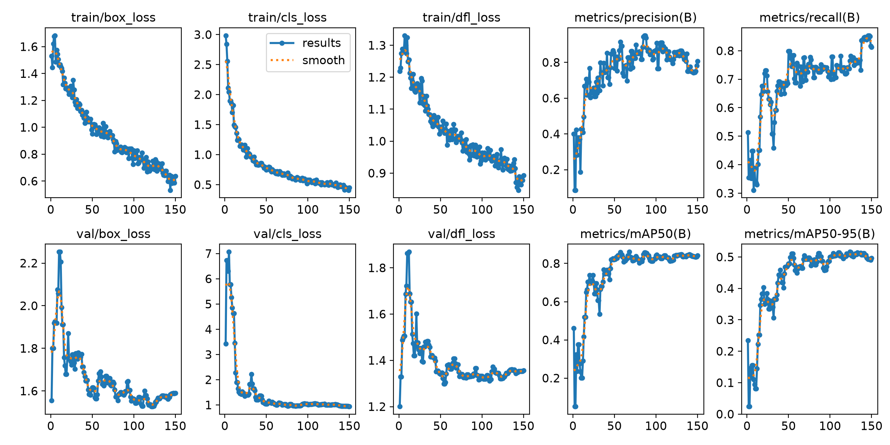
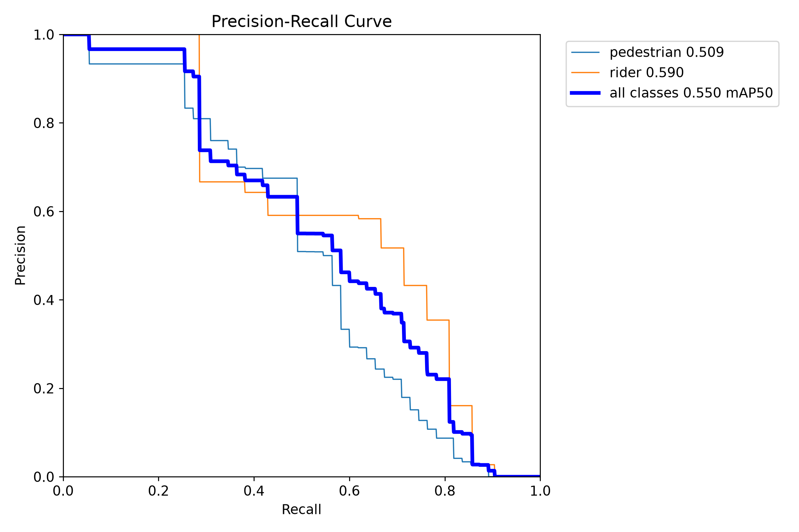
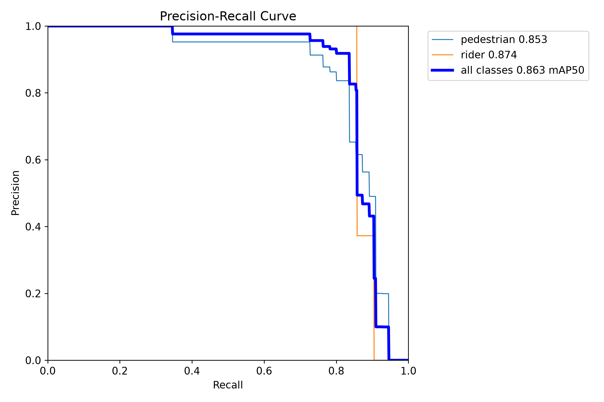

# Version 2 (2026) : YOLOv8n pré-entraîné, évalué sur un test séparé

La v1 a été remise en 2024 et reste présentée telle quelle à la racine du dépôt. Cette v2 reprend le même problème, les mêmes 75 images annotées et la même architecture YOLOv8n, en corrigeant les trois limites de la v1 relevées dans la section « Écarts relevés » du [README principal](../README.md) :

| Limite de la v1 | Ce que fait la v2 |
|---|---|
| Modèle construit à partir de `yolov8n.yaml`, l'architecture seule, sans poids pré-entraînés | Affinage à partir de `yolov8n.pt`, pré-entraîné sur COCO |
| Les 15 images de validation servent à la fois à choisir les poids et à mesurer les performances | Trois ensembles disjoints : 48 images d'entraînement, 12 de sélection, 14 de test, ce dernier utilisé une seule fois |
| Deux images de validation (12.jpg et 13.jpg) sont la même photo, annotée deux fois | Le doublon est écarté du test ; seule 12.jpg, la plus complètement annotée (18 boîtes contre 16), est gardée |

## Données

| Ensemble | Images | Piétons | Cyclistes ou motards | Origine |
|---|---|---|---|---|
| Entraînement | 48 | 196 | 70 | Images d'entraînement de la v1 |
| Sélection des poids | 12 | 58 | 21 | Images d'entraînement de la v1, tirées au hasard (graine 2026) |
| Test | 14 | 55 | 21 | Images de validation de la v1, sans le doublon |

La liste des images de chaque ensemble est dans [`splits.json`](splits.json). Les images ne sont pas redistribuées.

## Entraînement

YOLOv8n (3,1 millions de paramètres), affiné à partir des poids COCO : 150 époques au plus avec arrêt anticipé (patience de 40), images de 640 pixels, lots de 8, augmentations par défaut d'Ultralytics, graine 0, mode déterministe. Entraînement sur processeur (52 minutes) avec Ultralytics 8.4.216 et PyTorch 2.15.

Les poids retenus sont ceux de l'époque 124, qui maximise le critère d'Ultralytics (0,1 × mAP@0,5 + 0,9 × mAP@0,5:0,95) sur l'ensemble de sélection : mAP@0,5 = 0,844. Paramètres complets : [`results/parametres_entrainement_v2.yaml`](results/parametres_entrainement_v2.yaml) ; journal par époque : [`results/journal_entrainement_v2.csv`](results/journal_entrainement_v2.csv).

<p align="center"></p>

## Résultats sur le test (14 images, 76 instances)

Les deux versions sont évaluées avec la même version d'Ultralytics et les mêmes réglages (images de 640 pixels, seuil de confiance 0,001, IoU de NMS 0,7). Le score de la v1 sur ces images est même avantagé, puisque ses poids ont été choisis sur elles.

| Modèle | Classe | Précision | Rappel | mAP@0,5 | mAP@0,5:0,95 |
|---|---|---|---|---|---|
| v1 (`models/best.pt`) | toutes | 0,577 | 0,566 | 0,550 | 0,223 |
| | piétons | 0,658 | 0,418 | 0,509 | 0,198 |
| | cyclistes ou motards | 0,496 | 0,714 | 0,590 | 0,249 |
| **v2** (`v2/best_v2.pt`) | **toutes** | **0,955** | **0,794** | **0,863** | **0,534** |
| | piétons | 0,910 | 0,737 | 0,853 | 0,526 |
| | cyclistes ou motards | 1,000 | 0,851 | 0,874 | 0,543 |

### Intervalles de confiance

Avec 14 images, un seul score ne suffit pas. Les intervalles à 95 % ci-dessous viennent d'un bootstrap sur les images : 2 000 rééchantillonnages avec remise, en recalculant à chaque fois le mAP des deux modèles sur les mêmes images, à partir des statistiques par image de l'évaluateur d'Ultralytics ([`bootstrap_v2.py`](bootstrap_v2.py)).

| Mesure | v1 | v2 | Différence v2 − v1 |
|---|---|---|---|
| mAP@0,5 | 0,550 [0,403 ; 0,702] | 0,863 [0,792 ; 0,942] | **+0,314 [0,144 ; 0,483]** |
| mAP@0,5:0,95 | 0,223 [0,153 ; 0,302] | 0,534 [0,486 ; 0,613] | **+0,311 [0,237 ; 0,425]** |

Les intervalles de la différence excluent zéro, et la v2 l'emporte dans les 2 000 tirages. Le gain vient de l'initialisation à partir de COCO : avec seulement 48 images d'entraînement, partir de poids qui reconnaissent déjà les personnes change nettement le résultat.

<p align="center">
  
  
</p>

Matrices de confusion : [v1](results/figures/matrice_confusion_v1_test.png) · [v2](results/figures/matrice_confusion_v2_test.png). Toutes les valeurs : [`results/metriques_v1_v2.csv`](results/metriques_v1_v2.csv) et [`results/bootstrap_map_test.csv`](results/bootstrap_map_test.csv).

### Ce que révèle la réévaluation de la v1

Évalués aujourd'hui sur les 15 images de validation d'origine, doublon compris, les poids de la v1 déployés dans les interfaces obtiennent un mAP@0,5 de 0,519, et non les 0,685 rapportés. Cela confirme qu'ils viennent d'un autre entraînement que celui dont le notebook présente les résultats. Une part de l'écart peut aussi venir du changement de version d'Ultralytics (8.2 en 2024, 8.4 ici). Sur ces mêmes 15 images, la v2 obtient 0,857.

## Limites

- **Taille du test.** 14 images et 76 instances : les intervalles de confiance restent larges, et les scores sont indicatifs.
- **Un seul entraînement.** Une seule graine a été utilisée. La variabilité d'un entraînement à l'autre n'est pas mesurée.
- **Données.** Les 75 images ont été rassemblées et annotées pour le projet. Elles ne couvrent ni la nuit, ni la pluie, ni la diversité des scènes d'un jeu comme Cityscapes.

## Reproduire

Depuis la racine du dépôt, avec le dossier des 75 images annotées (`images/` et `labels/`, sous-dossiers `train/` et `val/`) :

```bash
pip install ultralytics
python v2/prepare_donnees.py <dossier des images annotées>
python v2/train_v2.py          # environ une heure sur processeur
python v2/evaluate_v2.py       # tableau v1 / v2, courbes et matrices de confusion
python v2/bootstrap_v2.py      # intervalles de confiance
```

| Fichier | Rôle |
|---|---|
| `prepare_donnees.py` | Construit les ensembles d'entraînement, de sélection et de test à partir de `splits.json` |
| `train_v2.py` | Entraînement de la v2 |
| `evaluate_v2.py` | Évaluation comparée de la v1 et de la v2 |
| `bootstrap_v2.py` | Intervalles de confiance par bootstrap |
| `best_v2.pt` | Poids retenus de la v2 (6 Mo), utilisés par la démo en ligne |

---

*English: Version 2 fine-tunes YOLOv8n from COCO-pretrained weights on the same 75 hand-annotated images, with disjoint training (48), selection (12) and test (14) sets; a duplicated validation image is removed. On the held-out test set, mAP@0.5 rises from 0.550 (v1) to 0.863 (v2) and mAP@0.5:0.95 from 0.223 to 0.534. Image-level bootstrap 95% intervals for the difference are [+0.14, +0.48] and [+0.24, +0.43]. Re-evaluated on its original 15 validation images, the deployed v1 checkpoint scores 0.519, not the reported 0.685.*
